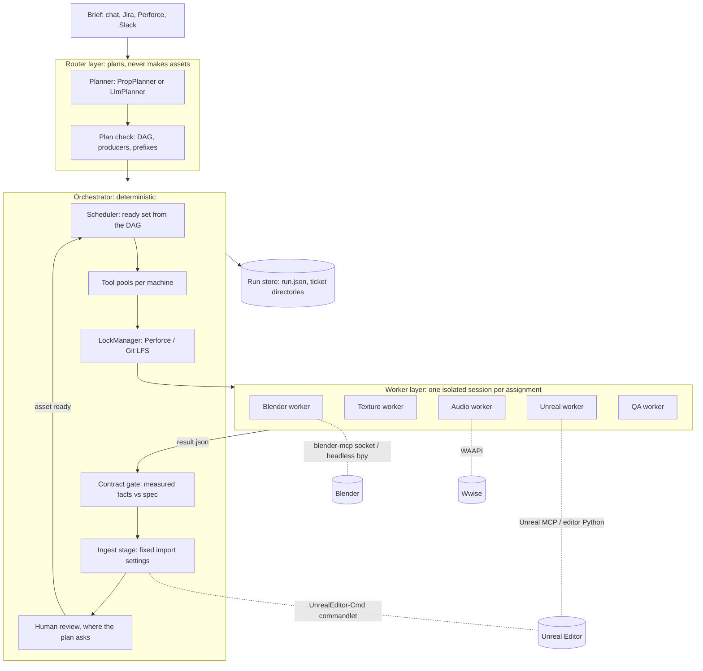

# 001 Architecture

This document maps the harness onto the super-agent design (DeepSeek's *Exploring Super-agent Design*, and the dsh-superagent prototype that implements part of it), describes the parts of this repository, and records why we build a small core instead of forking goose or dsh-superagent.

## The shape



## Mapping to the super-agent design

| Super-agent idea | Here | Status |
| --- | --- | --- |
| **Two levels: Router and Workers.** The Router handles people and dispatch, stays light and never runs tasks; Workers are isolated, one task each, and never talk to people | The **Planner** writes a plan and nothing else; the **Orchestrator** dispatches by code. **Workers** get one ticket, report through `result.json`, and never message people | Built |
| **Event-driven Triggers** with a fast deterministic filter before the model | A brief is today's only Trigger. Studio Sources follow the dsh-superagent `Source` shape: Perforce changelists, CI and cook failures, Jira/Linear tickets, Slack threads | M4 |
| **Subscriptions and pass-through**: follow-ups on a Thread go straight to the Worker that owns it | A person's `answer` goes straight to its ticket's next assignment, without re-planning. Asset-level subscriptions (a texture artist's comment on `SM_X` reaches the ticket that owns `SM_X`) come with Sources | Partly built |
| **Inline & Spill** context | The worker prompt inlines its specs, inputs, violations and notes, and references files by path (`src/executors/prompt.ts`) | Built |
| **Full duplex**: long tools run in the background | Bakes, exports and SoundBank generation are background jobs inside the worker runtime; the orchestrator runs workers concurrently, limited by pools | Built (runtime-dependent) |
| **Separating compute from execution environments** (a small daemon on each machine) | This matters most for game dev: DCCs need licences, GPUs and the project on disk, on artists' workstations. **Profiles** and **tool pools** describe each machine; the next step is a **tool-host daemon** per workstation that runs assignments for the central orchestrator | M3 |
| **Durable state; recovery after restart** | Every change is stored (`RunStore`); a restarted host requeues running tickets with a recovery note, keeps their locks, and never repeats a decision | Built |
| **Watchdog**: an outside loop that checks progress, not only liveness | Pool-slot and lock waits are logged; a watchdog that judges whether a worker is making progress (from its log and DCC state) and restarts stuck DCCs is a milestone | M4 |
| **Little human attention** | People see only what waits for them (`harness status`: review, questions, exhausted revisions). One concrete question at a time | Built |

What game dev adds that the article does not need:

- **Dependent tickets.** dsh-superagent's Tickets are independent; a studio plan is a DAG whose edges are assets.
- **A typed hand-off contract** checked by code, because a mesh with a misnamed hull "works" until it ships.
- **Exclusive locks on binary files**, mirrored to the studio's version control.
- **Stateful, scarce tools**: one editor per project per machine.

## Parts

| Part | Module | Does |
| --- | --- | --- |
| Model | `src/core/model.ts` | Zod schemas for everything that crosses a boundary: `Plan`, `TicketSpec`, `AssetSpec` (per kind), `AssetRecord`, `WorkerResult`, run state |
| Plan check | `src/core/plan.ts` | DAG from `consumes`/`after`, cycle detection, one producer per asset, domain may produce kind, naming prefixes, cross-references (an event's clip, a placement's class) must be edges; `waves` for display |
| Orchestrator | `src/core/orchestrator.ts` | Ready set → pool slot → locks → assignment → gate → revision / ingest / review → done. Person actions: `approve`, `answer`. Recovery after restart |
| Pools | `src/core/pools.ts` | Slots per tool pool; scheduler uses `tryAcquire`, pipeline stages `acquire` |
| Store | `src/core/store.ts` | Atomic JSON run state and one directory per ticket |
| Contracts | `src/contracts` | Naming rules, per-kind checks on measured facts, a WAV reader that measures the clip itself |
| Locks | `src/locks` | `LockManager` with memory, Perforce and Git LFS backends; injectable command runner |
| Presets | `src/presets`, `presets/*.json`, `profiles/*.json` | Least-privilege worker definitions; machine profiles; `${VAR}` resolution; MCP config rendering; tool-name mapping per agent runtime |
| Executors | `src/executors` | `SimulatedExecutor` (dry runs, demo, tests), `AgentCliExecutor` (any headless agent CLI), `gooseExecutor` (goose recipes) |
| Ingest | `src/ingest`, `dcc/unreal/import_pipeline.py` | Headless commandlet import with fixed settings and engine-side checks |
| Planner | `src/planner` | `propPlan` template; `LlmPlanner` over an OpenAI-compatible endpoint (DeepSeek by default) with a bounded repair loop |
| DCC scripts | `dcc/` | Blender export and inspection, Unreal import and inspection, Wwise WAAPI import, a stdlib audio synth |
| CLI | `src/cli.ts` | `plan`, `run`, `status`, `approve`, `answer`, `validate`, `presets`, `probe` |

### Ticket lifecycle

```
waiting ──inputs done──▶ queued ──slot + locks──▶ running ──ready──▶ validating ──pass──▶ (review ──approve──▶) done
                            ▲                         │                  │
                            │                         │                  └─fail, revisions left──▶ revising ─┐
                            │                         │                  └─fail, none left──▶ attention       │
                            │                         └─question / blocked / failed──▶ attention, blocked, failed
                            └──────────────── a person answers (or retries) ◀──────────────────────────────────┘
```

Locks are held from launch until `done` or `dropped`, including while a ticket waits for a person, so nobody else edits a half-fixed file. A worker's pool slot is held only while it runs; ingest takes its own slot.

## Why not fork goose or dsh-superagent?

**goose** (Rust, Apache-2.0) is a strong single-session agent with native MCP, many providers, and recipes that run headless with a required JSON response. Those are the properties of a good **Worker runtime**, so `gooseExecutor` turns each preset into a recipe: MCP servers become `extensions`, the report shape becomes `response.json_schema`. What goose does not have is what this project is about: a Router, Triggers and Threads, durable tickets that depend on each other, asset contracts, locks and tool pools. Forking would mean carrying a large, fast-moving Rust codebase in order to change the parts we do not need, while the parts we do need would still have to be written. Wrapping keeps upgrades free and lets each studio pick its runtime.

**dsh-superagent** (TypeScript, MIT) has the right domain discipline (Trigger, Eval, Mandate, Ticket, Assignment, Report; stored effects; recovery) and we follow its vocabulary and rules. But it targets one GitHub repository, its Tickets are independent, and it runs inside the DeepSeek Harness runtime (pre-release packages). The plan is to make this harness's orchestrator available as a **DSH bundle** too (M6): its `Executor` port matches DSH Executor Sessions, and Sources can be added the way its cookbook describes.

So: a small core we own (about 2,400 lines of TypeScript), and any agent runtime underneath it.

## Trust and safety

- Worker output is untrusted data: plans and results are parsed with schemas, paths may not leave the ticket directory, and facts are re-measured where the harness can (audio today; meshes through the inspection script).
- Workers never publish. `p4 submit`, `git push` and unlock are blocked commands in every preset; the host releases locks.
- Credentials stay out of prompts: presets reference variables, and agent runtimes read secrets from the environment or their keyring (goose `env_keys`).
- As in dsh-superagent, blocked commands and directories are defaults, not a sandbox. Run workers as a restricted OS user on machines that hold production depots.
